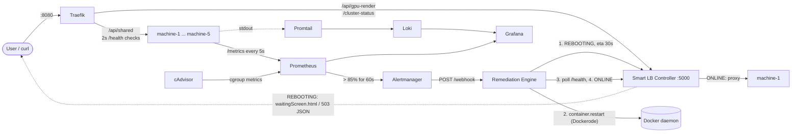
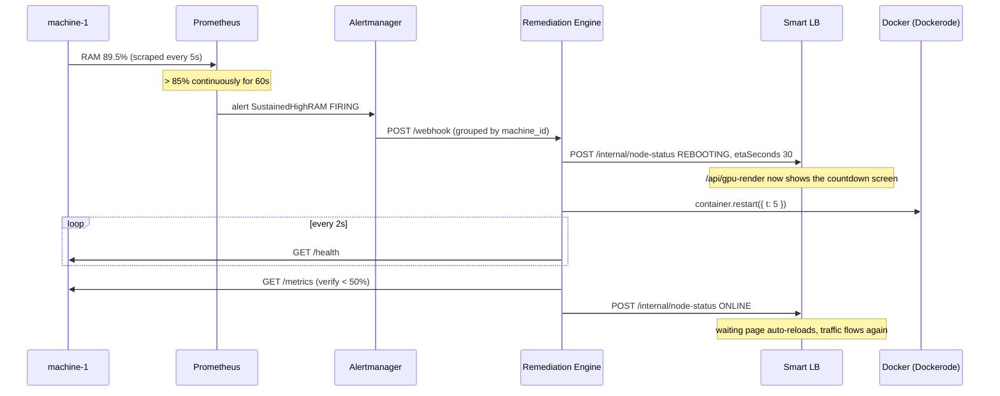

# Distributed Self-Healing Cluster & Smart Load-Balancing System

Five simulated server nodes sit behind **Traefik** and a **Smart LB Controller**. When any node holds **RAM, CPU or GPU > 85% for >= 60 s**, the system restarts it automatically and keeps users served while it heals - no human involved.

- **Shared service** `/api/shared` (all 5 nodes): Traefik routes around the rebooting node, zero dropped requests.
- **Exclusive service** `/api/gpu-render` (only `machine-1`): the Smart LB serves a live **countdown page** (browser) or `503` + `Retry-After` JSON (API) instead of a `502`, then auto-refreshes when the node is back.

## Architecture



### Self-healing sequence



## Quick start

Requires Docker with Compose v2 (Docker Desktop on Windows/macOS works).

```bash
cp .env.example .env        # optional, all values have defaults
docker compose up -d --build
docker compose ps           # wait until everything is "running"/"healthy"
```

| URL | What |
| :-- | :-- |
| http://localhost:8080/api/shared | Load-balanced shared service |
| http://localhost:8080/api/gpu-render | Exclusive GPU service (via Smart LB) |
| http://localhost:8080/cluster-status | Live node state registry |
| http://localhost:3000 | Grafana (dashboard "Self-Healing Cluster Overview", admin/admin) |
| http://localhost:9090 | Prometheus (`/alerts` shows the rules) |
| http://localhost:9093 | Alertmanager |
| http://localhost:8081 | Traefik dashboard |
| http://localhost:8082 | cAdvisor |
| http://localhost:4000/status | Remediation Engine history + cooldowns |
| http://localhost:3001 ... 3005 | `machine-1` ... `machine-5` directly (metrics + fault routes) |

## Demo: verify the whole loop

> On Windows PowerShell use `curl.exe` instead of `curl`.

```bash
# 1. Baseline
curl http://localhost:8080/api/shared          # rotates across machine-1..5
curl http://localhost:8080/api/gpu-render      # 200 from machine-1

# 2. Inject faults on machine-1 (RAM -> ~89.5%, GPU -> ~93%)
curl -X POST http://localhost:3001/fault/memory
curl -X POST http://localhost:3001/fault/gpu

# 3. Watch the 60s detection window in Grafana (http://localhost:3000):
#    machine-1 crosses the 85% line, Loki shows "[FAULT] ... injected on machine-1".
#    After >= 60s: http://localhost:9090/alerts -> FIRING
docker compose logs -f remediation-engine

# 4. During the reboot (~15-30s)
curl -i -H "Accept: application/json" http://localhost:8080/api/gpu-render   # 503 + Retry-After
#    ...or open http://localhost:8080/api/gpu-render in a browser: live countdown screen
for i in 1 2 3 4 5 6; do curl -s http://localhost:8080/api/shared; echo; done  # still 200 from machine-2..5

# 5. Recovery: the browser page reloads itself, /api/gpu-render returns 200 again
curl http://localhost:8080/cluster-status
curl http://localhost:4000/status
```

Other faults: `POST /fault/cpu`, `POST /fault/container-loop`, and `POST /fault/reset` (all on `:3001`..`:3005`).

Tear down: `docker compose down -v`

## Team workflow

| Person | Role | Branch | Owns |
| :-- | :-- | :-- | :-- |
| 1 | Target Node & Chaos Engineer | `feat/machine-node` | `machine-node/` |
| 2 | Orchestration & Remediation | `feat/remediation-engine` | `remediation-engine/`, `docker-compose.yml` |
| 3 | Smart LB, Traefik & UI | `feat/smart-lb` | `smart-lb-controller/` (+ Traefik labels) |
| 4 | Observability, Loki & Grafana | `feat/observability-stack` | `observability/` |

```bash
git clone https://github.com/iot-lab-kiit/Self-Healing-Service-.git
cd Self-Healing-Service-
git checkout feat/<your-branch>        # e.g. feat/machine-node
# ...work only inside your own folder...
git add <your-folder> && git commit -m "machine-node: ..."
git push
# open a PR into main when your part is ready
```

Rules:
- Stay inside the folder you own, so branches merge without conflicts. Changes to `docker-compose.yml` go through Person 2.
- Ports, metric names and JSON payloads in **Contracts** are frozen. Change them only if all four people agree, and update `CLAUDE.md` and this README in the same PR.
- Rebase on `main` before opening a PR: `git fetch origin && git rebase origin/main`.

### Known issue to pick up
- `remediation-engine` and `smart-lb-controller` use `axios` with default proxy settings. If a machine's Docker Desktop has an HTTP proxy configured, the internal calls (`http://machine-1:3000/health`) go through that proxy and fail. Fix: create the client with `axios.create({ proxy: false })` (Persons 2 and 3).

## Project layout

```text
.
├── docker-compose.yml          Traefik labels, 256m limits, self-healing-net
├── machine-node/               Express API, prom-client telemetry, fault injection
├── remediation-engine/         Alertmanager webhook -> handshake -> Dockerode restart -> verify
├── smart-lb-controller/        State registry, exclusive-service gatekeeper, waitingScreen.html
└── observability/              Prometheus, Alertmanager, Loki, Promtail, Grafana provisioning
```

## Contracts

**Metrics** (`GET /metrics` on every node, label `machine_id`): `node_ram_usage_percent`, `node_cpu_load_percent`, `node_gpu_utilization_percent`, `node_container_restart_count`, `node_active_connections`, plus default `prom-client` process metrics.

**Alertmanager webhook** `POST http://remediation-engine:4000/webhook` (alias: `/api/v1/remediate`) - standard Alertmanager v4 payload; `machine_id` label, falling back to `instance` host.

**LB handshake** `POST http://smart-lb-controller:5000/internal/node-status`

```json
{ "machineId": "machine-1", "status": "REBOOTING", "reason": "Sustained Resource Exhaustion (>85% for >=60s)", "exclusiveServices": ["gpu-render"], "etaSeconds": 30 }
{ "machineId": "machine-1", "status": "ONLINE" }
```

## Design notes

- **Memory fault** allocates real, committed buffers and plateaus at ~89% of the 256 MB limit (reported 89-90%), so the node stays above 85% for the full 60 s window without being OOM-killed. `memswap_limit` equals `mem_limit` so the limit is hard.
- **CPU metric** is per-container (process CPU time / wall time, one core). `systeminformation.currentLoad()` is host-wide, so it is exported separately as `node_host_cpu_load_percent` and never alerted on - a busy laptop must not trigger false reboots.
- **GPU**: `SIMULATE_GPU=true` reports an 8-15% baseline; `/fault/gpu` pins it at ~93%. With `SIMULATE_GPU=false` a readable physical GPU is used.
- **Alert grouping**: Alertmanager groups by `machine_id`, so RAM + GPU alerts on one node produce one webhook and one restart. The engine also enforces a 45 s per-node cooldown and an in-flight guard.
- **cAdvisor rules** (`ContainerMemoryNearLimit`, `ContainerCpuSaturated`) catch a node whose event loop is frozen and can no longer serve `/metrics`.
- **Logs survive restarts**: Promtail streams stdout/stderr to Loki continuously, so the crash evidence is stored before the container is restarted.
- **Accept negotiation**: `/api/gpu-render` during a reboot returns the HTML page only when the client prefers HTML (browsers). `curl` and API clients get JSON.
- **Remediation metrics** (`remediation_total`, `remediation_duration_seconds`, `remediation_last_duration_seconds`) feed the MTTR panels in Grafana.

## Troubleshooting

- **Traefik: "client version 1.24 is too old"** - Docker Engine 29+ needs a newer Traefik; `TRAEFIK_IMAGE` defaults to `traefik:v3.6`.
- **No cAdvisor data on Docker Desktop** - the out-of-band alerts stay silent, the in-app alerts still work.
- **Nothing happens after the fault** - check `http://localhost:9090/alerts`; the alert must be above 85% for a full 60 s. `docker compose logs remediation-engine` shows the webhook and cooldown decisions.
