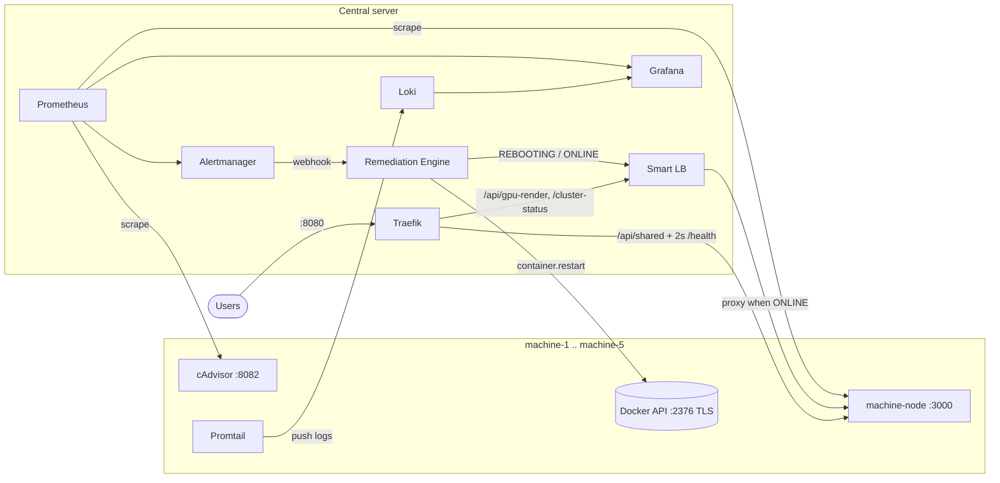

# Running on 5 physical machines

The default `docker-compose.yml` runs everything on one Docker host. For 5 real machines, the services split into two groups:

| Where | Runs | File |
|---|---|---|
| Each machine (`machine-1` … `machine-5`) | `machine-node`, cAdvisor, Promtail | `node.compose.yml` |
| One central server | Traefik, Smart LB, Remediation Engine, Prometheus, Alertmanager, Loki, Grafana | `server.compose.yml` |



## What changes compared with one host

| Concern | Single host | 5 machines |
|---|---|---|
| Finding the machines | Docker DNS (`machine-1` = container name) | `extra_hosts` maps `machine-N` to `MACHINE_N_IP`, so every component keeps the same names |
| Traefik routing | Docker labels (auto-discovery) | File provider (`traefik-dynamic.yml`): same router, same 2 s `/health` checks, same retry |
| Restarting a node | Local `/var/run/docker.sock` | `DOCKER_HOSTS`: each machine's Docker API over mutual TLS (`tcp://machine-N:2376`) |
| cAdvisor | One instance for all containers | One per machine, scraped at `machine-N:8082` |
| Logs | Promtail on the same host | Promtail on each machine pushes to the server's Loki (`LOKI_URL`) |
| Alert rules, dashboard, Smart LB, engine logic | unchanged | unchanged |

## Set-up

**On each machine:**

1. Expose the Docker API with TLS on port 2376. Docker's guide is "Protect the Docker daemon socket": create a CA and a server certificate for `machine-N`, then start `dockerd` with `--tlsverify --tlscacert --tlscert --tlskey -H tcp://0.0.0.0:2376`.
2. Firewall ports 2376, 3000 and 8082 so that only the server can reach them. The Docker API is root access, and `/fault/*` can take the node down.
3. Start the node. Set `EXCLUSIVE_SERVICE=true` on machine-1 only:

   ```bash
   MACHINE_ID=machine-1 EXCLUSIVE_SERVICE=true LOKI_URL=http://<server-ip>:3100/loki/api/v1/push docker compose -f node.compose.yml up -d --build
   ```

**On the server:**

1. Copy `server.env.example` to `server.env` and fill in the 5 machine IPs and a Grafana password.
2. Put each machine's client certificate in `certs/machine-N/{ca,cert,key}.pem`. Both `server.env` and `certs/` are git-ignored.
3. Start the server stack:

   ```bash
   docker compose --env-file server.env -f server.compose.yml up -d --build
   ```

## Trying it on one computer

`simulate.ps1` replaces the 5 machines with 5 separate Docker daemons (Docker-in-Docker). Each one has its own fixed IP (`172.30.0.11`–`.15`) and its own TLS Docker API, so the real `server.compose.yml` is exercised unchanged. Stop the single-host cluster first, because the ports overlap:

```bash
docker compose down
```

```bash
powershell -ExecutionPolicy Bypass -File deploy/multihost/simulate.ps1
```

```bash
powershell -ExecutionPolicy Bypass -File deploy/multihost/simulate.ps1 -Down
```

The simulation does not run cAdvisor or Promtail inside the simulated machines, so the `cadvisor` scrape targets are down and Loki only has the server's logs. The in-app alerts, the load balancer and the restarts all run exactly as on real hardware.
